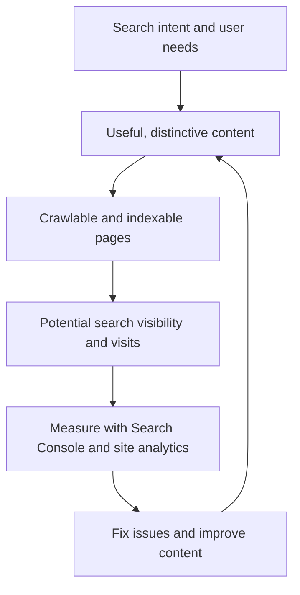
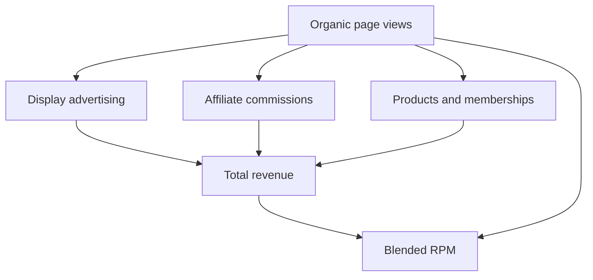

# awesome-seo

[简体中文](./README_CN.md)

A carefully curated collection of SEO guides, tools, and references for people who build and operate websites. Started as personal SEO notes in 2019; now maintained as a public knowledge resource by [i365](https://www.i365.tech/).

**New to SEO?** Begin with [Google Search Essentials](https://developers.google.com/search/docs/essentials) and the [official SEO Starter Guide](https://developers.google.com/search/docs/fundamentals/seo-starter-guide). Use Search Console to measure search visibility before choosing tools.

**Curation policy:** This is a reference list, not a product directory, advertising channel, or backlink placement service. Unsolicited vendor and self-promotional listings are not accepted. See [CONTRIBUTING.md](./CONTRIBUTING.md).

---

## Basic Concept

### The SEO improvement loop

*Indexable does not mean ranked: visibility depends on relevance, competition, and search-engine decisions.* The loop is about publishing helpful pages, observing results, and improving them—not producing links or content for their own sake.

The following older mind map is a broad reference; check current [Google Search documentation](https://developers.google.com/search/docs) for technical guidance.

## Tutorials

[Google Search Essentials](https://developers.google.com/search/docs/essentials)
> Google's baseline technical requirements, spam policies, and search best practices.

[Google SEO Starter Guide](https://developers.google.com/search/docs/fundamentals/seo-starter-guide)
> Google's introduction to making content accessible, useful, and discoverable through Search.

[The Beginner's Guide to SEO](https://moz.com/beginners-guide-to-seo)
> SEO beginners tutorial on the Moz web, helps you learn SEO systematically.

[A Technical SEO’s Guide to Crawl Budget Optimization](https://prerender.io/resources/free-downloads/white-papers/crawl-budget-guide/)
> A comprehensive guide explaining the importance of crawl budgets in managing indexing for search engines, how it impacts website traffic, and provides optimization tips to improve online visibility and SEO results.

## Books

[The Art of SEO](https://book.douban.com/subject/3780812/)
> In this book, four of the most noted experts in the field of search engine optimization (SEO) provide you with proven guidelines and cutting-edge techniques. The third edition was written in 2015, so if you only want to read one book about SEO, this book is the best option.

[这就是搜索引擎](https://book.douban.com/subject/7006719/)(Chinese Book)
> This book is about the internal technology of popular science search engines. Although Using SEO does not need to understand the internal implementation of search engines, for some technical optimization, understanding the characteristics of some search engines will help you optimize your website from a macro perspective.

## Article/Video

[How Search Works](https://www.youtube.com/watch?v=BNHR6IQJGZs)
> The videos about popular science search engine that Google published.

[12 SEO Best Practices That Everyone Should Follow](https://ahrefs.com/blog/seo-best-practices/)
> SEO best practices that Ahrefs write.

[17 Actionable Content Marketing Tips For More Traffic](https://backlinko.com/content-marketing-tips)
> The content marketing is one of important directions in SEO. The article content mainly involves content marketing suggestions, and it written by Brian Dean who research backlink.

[Here’s What We Learned About SEO](https://backlinko.com/search-engine-ranking)
> The article studies the factors influencing search engine rankings through large amounts of data analysis.

[What Is SEO Writing? How to Be a Better SEO Writer](https://ahrefs.com/blog/seo-writing/)
> The article mainly introduce the writing framework of SEO, and suggestions about how to be a better SEO write.

[The Authority Site Business Model](https://www.authorityhacker.com/what-is-an-authority-site/)
> The article introduce the whole process that an authority site from construction to profitability.

[零成本搭建SEO友好型博客指南](https://www.bmpi.dev/series/%E9%9B%B6%E6%88%90%E6%9C%AC%E6%90%AD%E5%BB%BA%E7%8E%B0%E4%BB%A3%E5%8D%9A%E5%AE%A2%E6%8C%87%E5%8D%97/)(Chinese Blogs)

> This is a series of blogs that introduces how to build a SEO from scratch. These blogs content covered blog building, SEO optimization, subcribe and push, website loading speed optimization.

[Logfile Analysis for SEO](https://www.suganthan.com/blog/logfile-analysis-seo/)
> This article detail explains how to analyse website access logs to identify problems in SEO. Google Analytics can help us understand user access, and system logs can help us better understand crawler requests, website techical SEO issues such as 301 redirects and so on.

### Google Ads

[Google Ads Benchmarks for YOUR Industry](https://www.wordstream.com/blog/ws/2016/02/29/google-adwords-industry-benchmarks)
> Last updated: October 5, 2020. 
> It can help to learn about the money-sucking power of each industry.

[如何准确查询关键词热度和搜索量](https://www.onepound.cn/article_info-144.html)(Chinese Website)

> For knowing what's hot on the web and avoiding Red Sea competition.

## Tools

The resources below prioritize official search-engine tools, mature open-source projects, and established industry tools—not new vendor listings.

### Search performance and indexing

[Google Search Console](https://search.google.com/search-console/about)
> Google's first-party tool for search queries, page performance, indexing, and crawl diagnostics.

[Search Console API](https://developers.google.com/webmaster-tools/)
> Query Google Search data, manage sitemaps, and inspect URL indexing status programmatically; requires property access.

[Bing Webmaster Tools](https://www.bing.com/webmasters/about)
> Microsoft's first-party search performance, indexing, crawling, and keyword diagnostics.

[Google Trends](https://trends.google.com/trends/explore)
> Compare relative search interest and trends across topics, regions, and time; not a source of absolute search volume.

### Technical auditing and structured data

[Google Rich Results Test](https://search.google.com/test/rich-results)
> Google's official test for structured data eligible for rich-result features in Google Search.

[Schema Markup Validator](https://validator.schema.org/)
> Validate Schema.org JSON-LD, RDFa, and Microdata independently of Google-specific rich-result eligibility.

[Google Lighthouse](https://github.com/GoogleChrome/lighthouse)
> Google's open-source audits for page performance, accessibility, SEO, and best practices.

[Lighthouse CI](https://github.com/GoogleChrome/lighthouse-ci)
> Run Lighthouse audits and regression assertions in continuous integration.

[Screaming Frog SEO Spider](https://www.screamingfrog.co.uk/seo-spider/)
> Established desktop crawler for technical SEO, including broken links, redirects, and metadata; the free version crawls up to 500 URLs per run.

### Other established tools

[advertools](https://github.com/eliasdabbas/advertools)
> Python library providing a comprehensive set of SEO and digital marketing tools.

[ahrefs](https://ahrefs.com/)
> SEO conprehensive analysis tool. 

[semrush](https://www.semrush.com/)
> SEO conprehensive analysis tool. 

[Screpy](https://screpy.com/)
> SEO platform for technical audits, rank tracking, Core Web Vitals, uptime monitoring, and reports.

[webpagetest](https://www.webpagetest.org/)
> Website speed measurement tool, essential for technical SEO optimization.

[google pagespeed insights](https://developers.google.com/speed/pagespeed/insights/)
> Website speed measurement tool, essential for technical SEO optimization.

[majestic](https://majestic.com/)
> Website Backlink Analysis Plugins. 

[moz](https://moz.com/)
> Open Site Explorer/MozBar Plugins. 

[linkresearchtools](https://smart.linkresearchtools.com/seo-tools/free-seo-tools/)
> Free SEO Tools. 

[raventools](https://raventools.com/)
> A comprehensive toolbox for link building. 

[authoritylabs](https://www.authoritylabs.com/)
> Track search engine rankings / Solve the problem of GA that keywords not provided.

[quantcast](https://www.quantcast.com/)

> Website Traffic View Tools. 

[seoquake](https://www.seoquake.com/index.html)
> SEO Chrome Plugin that published by semrush. 

[spyfu](https://www.spyfu.com/)

[Prerender](https://prerender.io/)
> Prerender serves 100% cached versions of your web pages to search engine bots that have problems executing JavaScript.

## AI Search, GEO, and Agent Accessibility

**Generative Engine Optimization (GEO)** is best approached as a discoverability and measurement problem—not a replacement for SEO, nor a promise of getting cited by a model. Start with useful original content, stable URLs, accessible HTML text, descriptive titles, internal links, and structured data consistent with visible page content.

### Verified guidance

[Google: AI features and your website](https://developers.google.com/search/docs/appearance/ai-features)
> Google says AI Overviews and AI Mode have no additional technical requirements beyond eligibility for Google Search. Crawlability, textual content, and accurate structured data still matter.

[Google: Generative AI performance reports in Search Console](https://developers.google.com/search/blog/2026/06/gen-ai-performance-reports)
> Official reports for impressions and pages surfaced in generative AI features on Search and Discover; Google says the reports were available worldwide by August 31, 2026. Impressions are not visits or conversions.

[OpenAI: crawler documentation](https://developers.openai.com/api/docs/bots)
> Distinguishes `OAI-SearchBot` (ChatGPT search discovery), `GPTBot` (potential model-training crawl), and `ChatGPT-User` (certain user-triggered requests). Do not assume one robots.txt policy controls all three identically.

[Anthropic: Claude crawler controls](https://support.claude.com/en/articles/8896518-does-anthropic-crawl-data-from-the-web-and-how-can-site-owners-block-the-crawler)
> Documents distinct `Claude-SearchBot`, `ClaudeBot`, and `Claude-User` purposes and controls.

[Google: robots.txt guidance](https://developers.google.com/search/docs/crawling-indexing/robots/intro)
> Manage crawler access intentionally. Robots.txt is not authentication, an authorization mechanism, or a reliable way to keep private pages secret. Verify CDN/WAF challenges and real fetch responses separately.

[WAI-ARIA Authoring Practices](https://www.w3.org/WAI/ARIA/apg/)
> Accessible, semantically labeled buttons, forms, and navigation improve usability for people and can help browser-based agents interpret interactions. ARIA alone does not guarantee agent compatibility.

### Experimental rather than required

[llms.txt proposal](https://llmstxt.org/)
> A voluntary proposal for machine-readable Markdown navigation and linked documentation. It may be useful for agent-facing technical docs, but is **not** a universally adopted search standard or a Google ranking requirement. Google explicitly says llms.txt has no positive or negative impact on Google Search visibility. Maintain it only if a specific consumer or measurable use case justifies the extra content.

**Practical distinction:** *search crawlers*, *model-training crawlers*, and *user-directed browser/agent sessions* are different actors. A bot fetch is not a human referral; browser analytics generally does not measure crawler traffic. Never bypass login, privacy, abuse prevention, or payment controls to improve purported “AI friendliness.”

### If your site uses Cloudflare or another CDN/WAF

**robots.txt and edge security are different controls.** A crawler allowed by robots.txt can still receive a Cloudflare 403/429, challenge page, or other unusable response. Likewise, allowing a crawler through the WAF does not override its robots.txt obligations. Audit both layers rather than assuming a public page is machine-accessible.

[Cloudflare: AI bot policies](https://developers.cloudflare.com/bots/additional-configurations/block-ai-bots/)
> Cloudflare distinguishes **Search, Agent, and Training** behavior. New-domain defaults introduced September 15, 2026 keep Search allowed but restrict Training and Agent on pages with ads; mixed-purpose bots may also be blocked by training policies. Check each zone's **actual** settings; existing domains and configurations may differ.

[Cloudflare: managed robots.txt](https://developers.cloudflare.com/bots/additional-configurations/managed-robots-txt/)
> Cloudflare's Bot Preference Sync can **prepend managed rules** to an existing robots.txt, based on the zone's policies. Read the **final public** `https://your-domain.example/robots.txt`, not just the file in Git, and check for conflicts.

[Cloudflare: AI Crawl Control](https://developers.cloudflare.com/ai-crawl-control/get-started/)
> Review **AI Crawl Control → Crawlers / Directives** for request outcomes and robots policy. On Free plans, crawler recognition is primarily user-agent based; don't treat this dashboard as independently verified attribution.

[Cloudflare: bot false positives](https://developers.cloudflare.com/bots/troubleshooting/false-positives/)
> Bot Fight Mode can challenge legitimate clients and **cannot be skipped with a WAF custom rule**. Super Bot Fight Mode supports targeted Skip rules. Inspect **Security Events / Analytics** before changing protections.

**Minimal audit for a public content page:**
1. Decide whether you want **AI search discovery**, **user-directed agent access**, and/or **training** independently. For example, OpenAI documents allowing `OAI-SearchBot` for search while disallowing `GPTBot` for training.
2. Fetch the public `/robots.txt` and sitemap over your **real CDN hostname**. Check effective policies and Cloudflare-generated directives. Ensure public article/asset-detail URLs return meaningful text and a canonical URL, without requiring login or Turnstile.
3. Check Cloudflare **Security Events** and AI Crawl Control for actual requests from identified bots: status codes, blocked/challenged decisions, and the precise host/path. A `curl -A "OAI-SearchBot"` probe checks only the declared user agent and **does not prove** how the authentic verified crawler is treated.
4. Resolve unintended challenges **only for known-good traffic on public read-only paths**. Do not broadly bypass protections for every user agent claiming to be a search bot; keep downloads, paid content, APIs, and write actions behind their original authorization and anti-abuse controls.
5. Recheck after changes to DNS proxy/CDN, robots.txt, WAF, or bot settings. Record actual fetch responses rather than assuming a configuration toggle guarantees indexing or referrals.

## Chrome Plugins

[SimilarWeb](https://chrome.google.com/webstore/detail/similarweb-traffic-rank-w/hoklmmgfnpapgjgcpechhaamimifchmp)
> The plugin to check the PV traffic of website. But the results are sometimes accurate and sometimes biased.

[SEOquake](https://chrome.google.com/webstore/detail/seoquake/akdgnmcogleenhbclghghlkkdndkjdjc)
> Check the SEO-related information of the website, such as the number of external links, the number of indexes, and SEO Internal website issues, etc.

[Keyword Surfer](https://chrome.google.com/webstore/detail/keyword-surfer/bafijghppfhdpldihckdcadbcobikaca)
> This is a keyword tool to view monthly search volume for a number of keywords. 
> Of course, you also can use Keyword Planner of Google Ads to view monthly search volume for a number of keywords. 

[SEO Minion](https://chrome.google.com/webstore/detail/seo-minion/giihipjfimkajhlcilipnjeohabimjhi)
> The view tool for common internal issues of website.

[META SEO inspector](https://chrome.google.com/webstore/detail/meta-seo-inspector/ibkclpciafdglkjkcibmohobjkcfkaef)
> The view tool for meta data of website.

## Blog/Twitter

[SEO Twitter List](https://twitter.com/i/lists/1341048200677842950)
> The list mainly show SEO masters Twitter.

[backlinko](https://backlinko.com/)
> Brian Dean’s Blog (He has some achievements in backlink research.)

[Google Search Central Blog](https://developers.google.com/search/blog)
> Published by Google.

[ahrefs blog](https://ahrefs.com/blog/)
> High-quality blogs about SEO that published by ahrefs. 

[moz](https://moz.com/blog)
> High-quality blogs about SEO that published by moz. 

[英文SEO实战派](https://www.seoactionblog.com/)(Chinese Blog)
> Author: John. He has amount of research on Google Authority Site.

[富裕者联盟](https://www.fuyuzhe.com/)(Chinese Blog)
> The author is Affiliate master, It can help you learn some online earning techniques.

[Harris](https://www.yesharris.com/learning-seo-menu/)(Chinese Blog)
> About SEO Timeliness.

[SEO前线](http://seoqx.com/)(Chinese Blog)
> Author: noname. He main research Baidu SEO.

[Other](https://ahrefs.com/blog/seo-blogs/)
> Collected by ahrefs.

## Community

[Reddit SEO](https://www.reddit.com/r/SEO/hot/)

[Black Hat World](https://www.blackhatworld.com/)

[Webmaster World](https://www.webmasterworld.com/home.htm)

[Warrior Forum](https://www.warriorforum.com/)

> If you want to recommend other good communities, please commit PR.

## Analytics, Attribution, and Conversion

Measure **discovery → qualified visits → meaningful product use → revenue**. Different tools answer different questions; page views, bot requests, AI citations, signups, and paid customers are not interchangeable.

| Question | Practical source |
| --- | --- |
| Which search queries and pages receive impressions and clicks? | Search Console; Bing Webmaster Tools |
| Is a page shown inside Google's generative AI search features? | Search Console generative AI performance reports (visibility/impressions) |
| Which users arrived through a browser referral or tagged link? | GA4, Umami, or Mixpanel (referrer and UTM) |
| Did visitors complete a valuable action and return? | Product-specific events, funnels, and retention |
| Was the growth worth its cost? | Verified sales/refunds and direct operating/production costs |

### Established analytics tools

[Google Analytics 4: traffic acquisition](https://support.google.com/analytics/answer/12923437)
> Analyze traffic sources, sessions, and key events. It complements Search Console; it does not replace search impression or crawler-log data.

[Mixpanel: funnel analysis](https://mixpanel.com/blog/introduction-to-analytics-funnel-analysis/)
> Established product analytics for conversion steps, usage, and retention after the visitor reaches the product.

[Umami](https://docs.umami.is/)
> Open-source web and product analytics with referrers, UTM parameters, custom events, funnels, and attribution reporting; can be self-hosted.

[Umami: attribution](https://docs.umami.is/docs/attribution)
> First-click and last-click attribution for chosen page views or events; these are reporting models, not proof of causal impact.

### Measurement cautions

- For ChatGPT-originated visits, inspect observed referrers and UTM parameters (for example, `utm_source=chatgpt.com` when present). **Do not assume all ChatGPT or other AI referrals are tagged**, or classify all direct traffic as AI-driven. [OpenAI's current crawler documentation](https://developers.openai.com/api/docs/bots) describes bot discovery—not how every browser referral is attributed.
- Server/CDN logs can show crawler requests, but those are **not** user sessions or citations. GSC AI impressions likewise do not establish click-through or revenue.
- Define meaningful events per product (e.g., a verified artifact download, completed research workflow, or purchase). Deduplicate and validate events, document attribution limitations, and separate gross revenue from costs.
- Choose analytics according to the question and existing stack; **do not install all three trackers** just because they are listed.

## Traffic Monetization

Organic search traffic creates opportunities, not revenue by itself. Common models include advertising, affiliate commissions, and selling products or memberships.

**Blended RPM = total revenue ÷ page views × 1,000.** This measures revenue per 1,000 page views across the channels shown; it is different from an ad platform's *ad-only* RPM. Track conversions and operating costs separately to understand profitability. Results vary by niche, geography, audience, and product fit—historical CPM/CPC benchmarks are not universal assumptions.

## Other

[Google Algorithm Update History](https://moz.com/google-algorithm-change)
> Currently, Google has some of more important Google algorithms including the Panda algorithm, the Penguin algorithm, and the Hummingbird algorithm.
> This is the page that Moz tracks updates to Google's search algorithm.

[State of the Web](https://httparchive.org/reports/state-of-the-web)
> Some reports on important statistics related to HTTP on the Internet, published by httparchive.

---

## Maintainers

Maintained by [i365](https://www.i365.tech/), an agent-native digital product studio. This list is an independent reference collection; inclusion does not imply endorsement, partnership, or payment.
