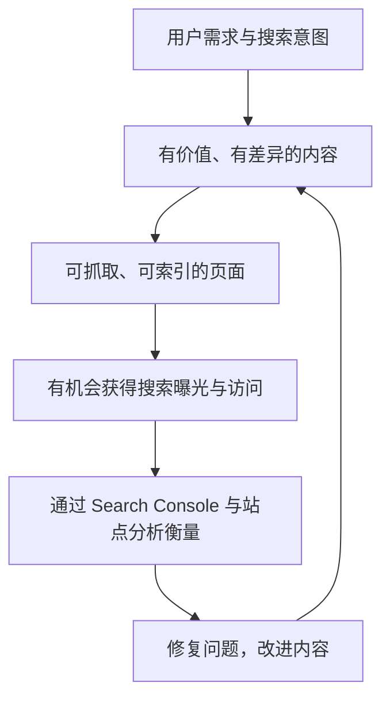
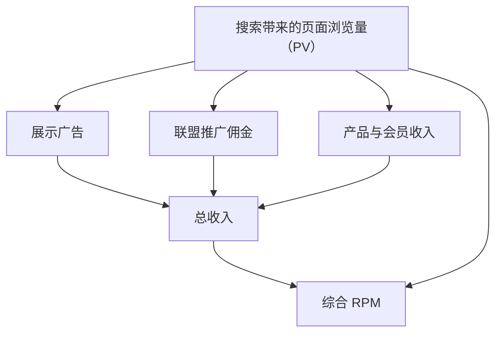

# awesome-seo

[English](./README.md)

一份面向网站开发者和运营者的 **精选 SEO 学习资料与工具清单**。最初整理于 2019 年，现由 [i365](https://www.i365.tech/) 作为公开知识资源维护。

**新手建议：**先读 [Google Search Essentials](https://developers.google.com/search/docs/essentials) 和 [Google SEO 入门指南](https://developers.google.com/search/docs/fundamentals/seo-starter-guide)，再用 Google Search Console 查看真实的搜索表现。

**收录原则：**这不是商业产品目录、广告投放渠道或外链交易列表。不接受未经邀请的厂商推广和项目自荐。详见 [CONTRIBUTING.md](./CONTRIBUTING.md)。

---

## 基础概念

### SEO 的持续改进闭环

*可索引不等于一定有排名或流量。* SEO 的核心是满足用户需求、观察实际效果、持续改进，而不只是不断增加页面数量。

下面保留了早期整理的 SEO 思维导图，适合了解涉及的领域；涉及技术细节时请以最新的 [Google 搜索文档](https://developers.google.com/search/docs) 为准。

## 教程

[Google Search Essentials](https://developers.google.com/search/docs/essentials)

> Google 搜索收录的基本技术要求、垃圾内容政策和最佳实践。

[Google SEO 入门指南](https://developers.google.com/search/docs/fundamentals/seo-starter-guide)

> Google 官方的 SEO 基础入门教程，介绍如何让搜索引擎理解网页并帮助用户找到内容。

[The Beginner's Guide to SEO](https://moz.com/beginners-guide-to-seo)

> Moz的SEO新手教程，可以系统性学习SEO。

[The Authority Site System 3.0](https://www.authorityhacker.com/system/)

> 这个课程是关于如何从零构建权威站（英文Niche站）并变现的，SEO只是其中一部分，还包括Affiliate，付费广告等。（课程费用比较贵，我还没开始学）

## 图书

[SEO艺术](https://book.douban.com/subject/34890213/)

> 国内的SEO垃圾书很多，这本是国外SEO三位大佬合写，第三版是2015年写的，时效性还行，如果只看一本关于SEO书的话，这本就够了。

[这就是搜索引擎](https://book.douban.com/subject/7006719/)

> 这本书是科普搜索引擎内部技术的，虽然搞SEO不需要了解搜索引擎内部实现，但是对于一些技术性优化，了解一些搜索引擎的特点有助于你从宏观局面优化网站。

## 文章/视频

[How Search Works](https://www.youtube.com/watch?v=BNHR6IQJGZs)

> Google出品的关于搜索引擎科普小视频。

[12 SEO Best Practices That Everyone Should Follow](https://ahrefs.com/blog/seo-best-practices/)

> ahrefs写的关于SEO的最佳实践。

[17 Actionable Content Marketing Tips For More Traffic](https://backlinko.com/content-marketing-tips)

> SEO里很重要一个方向是内容营销，这篇文章是反向链接研究大佬Brian Dean写的关于内容营销的建议。

[Here’s What We Learned About SEO](https://backlinko.com/search-engine-ranking)

> 这篇通过大量数据分析研究搜索引擎排名的影响因素。

[What Is SEO Writing? How to Be a Better SEO Writer](https://ahrefs.com/blog/seo-writing/)

> 基于SEO的写作建议和框架。

[The Authority Site Business Model](https://www.authorityhacker.com/what-is-an-authority-site/)

> 英文内容站从建设到盈利的一条龙流程介绍文章。

[零成本搭建SEO友好博客指南](https://www.bmpi.dev/series/%E9%9B%B6%E6%88%90%E6%9C%AC%E6%90%AD%E5%BB%BA%E7%8E%B0%E4%BB%A3%E5%8D%9A%E5%AE%A2%E6%8C%87%E5%8D%97/)

> 从零开始打造一个SEO友好的博客，涵盖博客搭建、SEO优化、订阅推送、国内及国外网站加载速度优化。

[Logfile Analysis for SEO](https://www.suganthan.com/blog/logfile-analysis-seo/)

> 此篇文章详细讲解了如何分析网站访问日志来发现SEO中的问题。GA可以帮助我们了解用户访问情况，系统日志能帮助我们更好的了解爬虫请求、网站技术性SEO问题如301跳转等问题。

### Google Ads

[Google Ads Benchmarks for YOUR Industry](https://www.wordstream.com/blog/ws/2016/02/29/google-adwords-industry-benchmarks)

> Last updated: October 5, 2020. 了解每个行业的吸金能力。

[如何准确查询关键词热度和搜索量](https://www.onepound.cn/article_info-144.html)

> 了解热度，规避红海竞争。

## 工具

以下优先收录搜索引擎官方工具、长期维护的开源项目和行业公认的工具；不按商业产品数量扩充目录。

### 搜索表现与收录

[Google Search Console](https://search.google.com/search-console/about)
> Google 官方站点工具，分析搜索查询、页面表现、索引与抓取问题。

[Search Console API](https://developers.google.com/webmaster-tools/)
> 通过 API 查询 Google 搜索表现数据、管理站点地图并检查网址索引状态；需要相应的站点权限。

[Bing Webmaster Tools](https://www.bing.com/webmasters/about)
> Microsoft 官方站长工具，提供 Bing 搜索表现、索引、抓取和关键词诊断。

[Google Trends](https://trends.google.com/trends/explore)
> 比较搜索主题与关键词的相对热度及变化趋势；数据不是绝对搜索量。

### 技术审计与结构化数据

[Google Rich Results Test](https://search.google.com/test/rich-results)
> Google 官方测试工具，检查页面中的结构化数据是否支持 Google 富媒体搜索结果。

[Schema Markup Validator](https://validator.schema.org/)
> Schema.org 结构化数据验证工具，检查 JSON-LD、RDFa 和 Microdata；不等于 Google 富媒体搜索结果资格检查。

[Google Lighthouse](https://github.com/GoogleChrome/lighthouse)
> Google 维护的开源网页审计工具，覆盖性能、可访问性、SEO 和最佳实践。

[Lighthouse CI](https://github.com/GoogleChrome/lighthouse-ci)
> 将 Lighthouse 审计与性能、SEO 回归检查纳入持续集成流程的开源工具。

[Screaming Frog SEO Spider](https://www.screamingfrog.co.uk/seo-spider/)
> 成熟的网站爬虫和技术 SEO 审计工具，可排查断链、重定向、元数据与站内结构；免费版单次可抓取 500 个 URL。

### 其他常用工具

[ahrefs](https://ahrefs.com/)

> 价格感人的SEO全面分析工具，如果有钱必备吧。

[semrush](https://www.semrush.com/)

> 价格感人的SEO全面分析工具，如果有钱必备吧。

[Screpy](https://screpy.com/)

> 提供技术 SEO 审计、排名追踪、Core Web Vitals、宕机监控和报告功能的平台。

[webpagetest](https://www.webpagetest.org/)

> 网站测速工具，技术性SEO优化必备。

[google pagespeed insights](https://developers.google.com/speed/pagespeed/insights/)

> 网站测速工具，技术性SEO优化必备。

[majestic](https://majestic.com/)

> 网站反向链接分析插件。

[moz](https://moz.com/)

> Open Site Explorer/MozBar插件。

[linkresearchtools](https://smart.linkresearchtools.com/seo-tools/free-seo-tools/)

> 免费SEO工具。

[raventools](https://raventools.com/)

> 链接建设全面工具箱。

[authoritylabs](https://www.authoritylabs.com/)

> 跟踪搜索引擎排名/解决GA关键词未提供问题。

[quantcast](https://www.quantcast.com/)

> 网站流量查看工具。

[seoquake](https://www.seoquake.com/index.html)

> semrush出品的SEO Chrome插件。

[spyfu](https://www.spyfu.com/)

## AI 搜索、GEO 与 Agent 可访问性

**GEO（生成式搜索优化）**首先是内容可发现性、可理解性与效果衡量问题，不是取代 SEO 的新排名秘诀，更不能保证被模型引用。优先做好有真实价值的原创内容、稳定 URL、可访问的 HTML 文本、清晰标题与站内链接，以及与页面可见内容一致的结构化数据。

### 已有明确依据的实践

[Google：AI 功能与网站](https://developers.google.com/search/docs/appearance/ai-features?hl=zh-cn)
> Google 明确说明：AI Overviews 和 AI Mode 没有额外的技术准入要求，仍应遵循常规搜索收录、可抓取性和内容质量要求。

[Google：Search Console 生成式 AI 表现报告](https://developers.google.com/search/blog/2026/06/gen-ai-performance-reports)
> 官方报告提供生成式 AI 搜索与 Discover 中的展示次数和网页等数据；Google 称已于 2026 年 8 月 31 日面向全球网站推出。曝光不等于访问或转化。

[OpenAI：爬虫官方说明](https://developers.openai.com/api/docs/bots)
> 分别说明 `OAI-SearchBot`（ChatGPT 搜索发现）、`GPTBot`（可能用于模型训练的抓取）、`ChatGPT-User`（部分用户主动触发的访问）。不能假设同一条 robots.txt 策略能完全控制三种行为。

[Anthropic：Claude 爬虫与控制策略](https://support.claude.com/en/articles/8896518-does-anthropic-crawl-data-from-the-web-and-how-can-site-owners-block-the-crawler)
> 分别说明 `Claude-SearchBot`、`ClaudeBot` 和 `Claude-User` 的不同用途。

[Google：robots.txt 指南](https://developers.google.com/search/docs/crawling-indexing/robots/intro)
> 按目的管理抓取；robots.txt 不是鉴权、安全屏障或隐藏私密页面的方法。还应检查 CDN/WAF 的实际挑战、拒绝响应和抓取可达性。

[WAI-ARIA Authoring Practices](https://www.w3.org/WAI/ARIA/apg/)
> 清晰的按钮、表单、标签与导航语义有利于无障碍访问，也有助于浏览器 Agent 理解操作；仅添加 ARIA 并不保证 Agent 一定可用。

### 实验性实践，不是必备项

[llms.txt 提案](https://llmstxt.org/)
> 自愿性的 Markdown 导航及文档索引格式，可用于明确有 Agent 消费需求的技术文档，但**并非普遍采用的搜索标准，也不是 Google 排名因素**。Google 已说明，llms.txt 对 Google 搜索可见性和排名既无正面也无负面影响。只有出现具体消费方或可衡量的使用价值时才值得额外维护。

**特别区分：** *搜索爬虫*、*训练爬虫*、*用户主动触发的浏览器/Agent 访问* 是不同场景。机器人抓取不等于真人访问，浏览器 Analytics 也通常不能测量爬虫请求。不能为了所谓“AI 友好”绕过登录、隐私、反滥用或付费保护。

### Cloudflare / CDN 托管网站的检查方法

**robots.txt 和 CDN/WAF 安全规则是两层独立控制。** 即使 robots.txt 允许爬虫访问，Cloudflare 仍可能返回 403/429、挑战页面或其他无法使用的响应；反过来，WAF 放行也不能代替 robots.txt 的规则。公开网页不等于爬虫一定能正常访问。

[Cloudflare：AI Bot 策略](https://developers.cloudflare.com/bots/additional-configurations/block-ai-bots/)
> Cloudflare 按 **Search、Agent、Training** 三种用途分类。2026 年 9 月 15 日开始的新域名默认策略允许 Search，但在广告页面限制 Training 和 Agent；兼具训练用途的混合爬虫也可能被训练禁用规则阻挡。应检查**当前域名的实际配置**，旧域名不一定采用新默认值。

[Cloudflare：托管 robots.txt](https://developers.cloudflare.com/bots/additional-configurations/managed-robots-txt/)
> Cloudflare 的 Bot Preference Sync 可能在源站 robots.txt **前面追加托管指令**。必须查看域名线上最终返回的 `/robots.txt`，不能只检查 Git 仓库文件。

[Cloudflare：AI Crawl Control](https://developers.cloudflare.com/ai-crawl-control/get-started/)
> 在 **AI Crawl Control → Crawlers / Directives** 检查抓取请求结果与 robots 策略。免费套餐主要根据 User-Agent 识别 AI 爬虫，不能把面板的识别结果全部当成独立验证的身份。

[Cloudflare：Bot 误拦截](https://developers.cloudflare.com/bots/troubleshooting/false-positives/)
> Bot Fight Mode 可能误拦合法客户端，而且**无法用 WAF 自定义 Skip 规则绕过**；Super Bot Fight Mode 支持限定范围的 Skip。修改安全设置前应先查看 **Security Events / Analytics**。

**公开内容页面的最小检查：**
1. 分别决定是否允许 **AI 搜索发现**、**用户主动触发的 Agent 访问**与**训练**。例如 OpenAI 官方明确支持允许 `OAI-SearchBot` 用于搜索，同时通过 robots.txt 禁止 `GPTBot` 用于训练。
2. 经真实的 **CDN 网站域名**读取 `/robots.txt`、Sitemap 和公开文章/资源详情页，核对托管规则、Canonical 和实际 HTML 文本。公开内容不应因登录或 Turnstile 无法读取。
3. 查看 Cloudflare **Security Events** 与 AI Crawl Control，分析已识别爬虫的请求、状态码、拦截/挑战事件、域名与路径。用 `curl -A "OAI-SearchBot"` 只能模拟 User-Agent，**不能证明真实已验证爬虫会得到同样的处理**。
4. 仅在**已确认的可信爬虫和公开只读路径**上排除误拦截；不要依据任何人都能伪造的 User-Agent 全站关闭安全规则。下载、付费内容、API 和写入操作继续保留鉴权与反滥用保护。
5. DNS 代理、CDN、robots.txt、WAF 或 Bot 设置修改后重新核查真实 HTTP 响应。允许抓取也不保证索引、AI 引用或引荐流量。

## Chrome插件

[SimilarWeb](https://chrome.google.com/webstore/detail/similarweb-traffic-rank-w/hoklmmgfnpapgjgcpechhaamimifchmp)

> 查看网站PV流量的工具，但是结果有时候准确，有时候偏差挺大的。

[SEOquake](https://chrome.google.com/webstore/detail/seoquake/akdgnmcogleenhbclghghlkkdndkjdjc)

> 查看网站的SEO相关的信息，如外链数量、索引数量、SEO的站内问题等。

[Keyword Surfer](https://chrome.google.com/webstore/detail/keyword-surfer/bafijghppfhdpldihckdcadbcobikaca)

> 关键词工具，可以查看一些关键词的月搜索量。也可以用Google Ads的Keyword Planner查看关键词的月搜索量。

[SEO Minion](https://chrome.google.com/webstore/detail/seo-minion/giihipjfimkajhlcilipnjeohabimjhi)

> 网站常见站内问题检视工具。

[META SEO inspector](https://chrome.google.com/webstore/detail/meta-seo-inspector/ibkclpciafdglkjkcibmohobjkcfkaef)

> 网页Meta信息查看工具。

## 博客/Twitter

[SEO Twitter List](https://twitter.com/i/lists/1341048200677842950)

> 我整理的一些SEO大佬的Twitter列表。

[backlinko](https://backlinko.com/)

> 反向链接研究大佬Brian Dean的博客。

[谷歌网站管理员中心博客](https://developers.google.com/search/blog)

> Google出品。

[ahrefs blog](https://ahrefs.com/blog/)

> ahrefs高质量的SEO博客，不过会在文章中推销他们价格感人的分析工具。

[moz](https://moz.com/blog)

> moz高质量的SEO博客。

[英文SEO实战派](https://www.seoactionblog.com/)

> 作者John，对Google英文内容站很有研究。

[富裕者联盟](https://www.fuyuzhe.com/)

> Affiliate大佬，可以学习一些网赚技术。

[Harris](https://www.yesharris.com/learning-seo-menu/)

> SEO知识时效性强的台湾博客。

[SEO前线](http://seoqx.com/)

> 对百度SEO很有研究的noname大佬的博客。

[其他SEO相关博客](https://ahrefs.com/blog/seo-blogs/)

> ahrefs整理的其他SEO相关的博客。

## 社区

[Reddit SEO](https://www.reddit.com/r/SEO/hot/)

[Black Hat World](https://www.blackhatworld.com/)

[Webmaster World](https://www.webmasterworld.com/home.htm)

[Warrior Forum](https://www.warriorforum.com/)

> 以上社区我都没怎么混过，只是偶尔会看一些帖子，如果你们有好的社区可以给我PR。

## 数据分析、流量归因与转化

重点衡量 **发现 → 有效访问 → 产品实际使用 → 收入**。不同数据源回答不同问题，不能把 PV、爬虫请求、AI 引用、注册数和付费客户混为一谈。

| 要回答的问题 | 主要证据来源 |
| --- | --- |
| 哪些查询和页面获得搜索曝光与点击？ | Search Console、Bing Webmaster Tools |
| 页面是否出现在 Google 生成式 AI 搜索功能里？ | Search Console 生成式 AI 表现报告（曝光数据） |
| 哪些访问来自浏览器引荐或带参数的链接？ | GA4、Umami 或 Mixpanel（Referrer、UTM） |
| 用户有没有完成有价值的操作并再次使用？ | 产品自定义事件、漏斗、留存 |
| 增长是否覆盖成本？ | 实际销售、退款与直接生产和运营成本 |

### 可靠的 Analytics 工具

[Google Analytics 4：流量获取报告](https://support.google.com/analytics/answer/12923437)
> 分析流量来源、会话和关键事件。它与 Search Console 互补，不能替代搜索曝光和爬虫日志数据。

[Mixpanel：漏斗分析](https://mixpanel.com/blog/introduction-to-analytics-funnel-analysis/)
> 成熟的产品分析工具，适合衡量用户到达网站后的关键行为、转化流程与留存。

[Umami](https://docs.umami.is/)
> 可自托管的开源网站及产品分析工具，支持 Referrer、UTM、自定义事件、漏斗和归因报告。

[Umami：归因分析](https://docs.umami.is/docs/attribution)
> 可按首次点击或末次点击模型追踪某个页面或事件的流量来源；归因模型不等于因果证明。

### 衡量时必须避免的误区

- [OpenAI 对网站发布者的说明](https://help.openai.com/en/articles/12627856) 提到 ChatGPT 搜索引荐链接可带 `utm_source=chatgpt.com`。应结合实际 Referrer 和 UTM；**其他 AI 助手不一定使用相同标签**，部分访问也可能丢失来源。不能把全部 Direct 流量都算成 AI 流量。
- CDN / 服务端日志中的爬虫请求不是用户 Session 或 AI 引用；GSC 的 AI 曝光也不代表实际点击与收入。
- 产品各自定义关键行为，例如已验证的资源下载、完成研究任务或真实支付；需要校验事件去重和归因限制，并将收入与成本分开衡量。
- 按现有产品技术栈与分析问题选择工具，**不需要因为清单列出三个平台就全部接入**。

## 流量变现

搜索流量本身不会直接产生收入。常见方式包括展示广告、联盟营销，以及销售自己的产品或会员服务。

**综合 RPM = 总收入 ÷ 页面浏览量（PV）× 1,000。** 它表示每千次页面浏览带来的全部渠道收入，不等同于广告平台只统计广告收入的 RPM。还要单独衡量转化率与运营成本，才能判断是否真正盈利。不同领域、地区和用户需求差异很大，不应直接套用旧的 CPM/CPC 区间。

## 其他

[Google Algorithm Update History](https://moz.com/google-algorithm-change)

> Google目前比较重要的一些算法有熊猫算法、企鹅算法及蜂鸟算法等。这是Moz追踪Google搜索算法的更新页面。

[State of the Web](https://httparchive.org/reports/state-of-the-web)

> httparchive出的关于互联网HTTP相关的一些重要统计数据的报告。

## 维护者

由 [i365](https://www.i365.tech/) 维护。本清单仅提供独立参考；收录不代表商业合作、付费推荐或质量担保。
